# Order Processing System

Student: Ahmed Moharam Mohamed kamal  

## Run it

The project targets `.NET 10` and has modes `phase1`, `phase2`, `phase3`, `phase4`, and `all`. With no arguments it shows a menu. Examples:

```sh
dotnet run --project 06-OrderProcessing/OrderProcessing -- phase1
dotnet run --project 06-OrderProcessing/OrderProcessing -- phase3 --cancel-after 4000
```

The data folder is `Path.Combine(AppContext.BaseDirectory, "Data")`, normally under the project output directory. Each phase calls the seeder at its required reset point.

## Structure and storage

`Shared/Models.cs` contains the required plain data classes and enums. `DataFiles` centralizes names and the data root. `JsonFileStore` reads and writes the collection JSON files; `DataSeeder` recreates seed records; `Log` serializes timestamp/thread/color output. `Phase1/` validates and compares sequential sync and async flows. `Phase2/` handles pricing, reservations, invoices and report generation. `Phase3/` contains checkout, payment and email interfaces and implementations, retry behavior, and cancellation compensation. `Phase4/` contains the completion stream, dashboard, carrier race, fraud scoring, and email resend.

The store uses UTF-8 JSON arrays, camel-case properties, indented output, and enum names. Each full file path has one `SemaphoreSlim` gate, so read-modify-write updates do not overwrite one another. Writes serialize to a temporary file beside the destination and move it into place when complete. Missing files return an empty list; invalid JSON raises `DataFileCorruptedException` with the file name. Invoice and report outputs are stored under `Data/invoices/` and `Data/reports/`.

## Performance record

Fill this table with values from actual runs. Timings depend on the machine; thread counts must be recorded from the output of the run being submitted.

For Phase 1, `Sync Time` and `Async Time` compare sequential validation only. The sync baseline intentionally does not persist its results, so async persistence is timed separately as `Async Save Time`; `Async Total Time` includes both validation and the required saves. Phase 2 and Phase 4 elapsed times below match the existing console screenshots. Thread counts come from the recorded instrumented runs; the screenshots do not display every thread counter.

| Measurement | Time | Distinct threads observed | ThreadPool.ThreadCount |
|---|---:|---:|---:|
| Phase 1 sync validation | 14.0 s | 1 | 4 before / 4 after |
| Phase 1 sequential async validation | 14.0 s | 4 | 4 before / 4 after |
| Phase 1 async save / total | 18.1 s / 32.1 s | 4 during save | 4 before / 4 after save |
| Phase 2 sequential pricing | 3566 ms | 2 | 7 before / 7 after |
| Phase 2 concurrent pricing | 2052 ms | 3 | 7 before / 7 after |
| Phase 2 concurrent processing | 6.7 s | 5 | 7 before / 9 after |
| Phase 3 sync, 10 dedicated threads | 18940 ms | 10 | 3 before / 3 after |
| Phase 3 async, 10 tasks | 6957 ms | 8 | 4 before / 9 after |
| Phase 4 dashboard for customer #3 | 513 ms (customer summary); dashboard loads finished in 504 ms | 6 | 8 before / 8 after |
| Phase 4 dashboard for customer #99 | Not found; dashboard loads finished in 504 ms | 4 | 8 before / 8 after |
| Phase 4 shipping quotes (#1–#5 total) | 4942 ms total (914, 789, 986, 1201, 1052 ms) | 4 across five runs | 8 before / 8 after |
| Fraud sequential | 5820 ms | 1 | 8 during Phase 4 run |
| Fraud parallel | 1048 ms; 5.55x speed-up | 8 | 8 during Phase 4 run |
| Email resend | 8.1 s | 4 | 8 before / 8 after |

These figures are from actual runs after adding thread observation. Timings and observed thread-pool sizes can vary by machine and scheduling; use the measurements printed by your own final run if they differ. Phase 3 comparison disables injected failures and processes orders #1–#10. Ahmed's captured run produced 8 Completed and 2 Rejected (#4 and #9) in both versions. The sync version creates and joins one dedicated `Thread` per order; the async version starts ten tasks and awaits them.

## Questions

### Phase 1

1. Sequential sync and sequential async runs perform the same work and wait for the same simulated latencies. Async releases a thread while waiting, but it does not make this sequential workflow finish sooner.
2. A continuation may resume on a different thread after an `await`; code must not assume the thread ID stays the same. Use the actual log lines from your run as evidence.
3. `Task.Delay` schedules a timer and does not block a thread for its duration. `Thread.Sleep` blocks the calling thread until the delay ends.
4. `Task<T>` lets a caller await I/O without blocking, compose the operation with other asynchronous work, and observe its result or exception.
5. `File.ReadAllTextAsync` represents asynchronous file I/O and accepts cancellation. The operating system/runtime handles the I/O wait; the caller's thread need not stay blocked for the whole disk wait.

### Phase 2

1. Calling an async method starts its synchronous prefix immediately. `await` suspends the current method if the task is incomplete and arranges its continuation.
2. A `Task` represents an operation, not necessarily a dedicated thread. `Task.Delay` waits on a timer and does not occupy a thread for the duration.
3. `.Result` and `.Wait()` block the calling thread. They can waste thread-pool workers or deadlock when a continuation needs a blocked context. The assignment permits them only in its separate comparison demo.
4. A task stores its exception. Awaiting observes and rethrows it; an unobserved task can hide a failure and may raise `UnobservedTaskException` later. Always keep and observe the task.
5. Use `Task.Run` to move CPU-bound work off a caller thread. Avoid wrapping naturally asynchronous file, database, or network I/O in `Task.Run`; await the I/O API directly.
6. `Task` has no result value; `Task<T>` has a result of type `T` available after it completes.
7. A monitor lock is thread-affine. An `await` can resume on another thread, so a `lock` body cannot safely span an await. Use an async-compatible primitive such as `SemaphoreSlim` when asynchronous mutual exclusion is required.
8. The unsafe reservation separates reading stock from writing its decrement, so concurrent orders can both approve the same last unit. The safe update holds one per-file gate across the read-modify-write and atomic file replacement.

### Phase 3

1. Async does not make one order's I/O intrinsically faster. It allows many workflows to wait concurrently without occupying one thread per wait.
2. A synchronous version creates and joins one thread per order; with 1,000 orders, thread memory and scheduling/context-switch costs become substantial.
3. Async is useful when a workflow spends time waiting on databases, files, or services: threads can serve other requests while the I/O is pending.
4. Await an operation whenever its result, completion, or failure affects the caller. Fire-and-forget is only reasonable when work is independently supervised and failures are reported elsewhere. `async void` cannot be awaited and its exceptions are difficult for callers to observe; event handlers are the main conventional exception because their delegate signature returns `void`.

### Phase 4

1. `Task.WhenEach` streams tasks in completion order; `Task.WhenAll` waits for every independent load; `Task.WhenAny` reacts to the earliest result and is suitable for competing carriers. One-by-one awaiting cannot print checkout completions in finish order, overlap the four dashboard loads, or select the first successful carrier.
2. Retain the `WhenAll` task and inspect `all.Exception.Flatten().InnerExceptions` after it faults. A plain `await` throws one exception to the caller.
3. Without cancellation, losing carriers keep using network, CPU, and service capacity after the quote is already chosen.
4. CPU fraud scoring benefits from multiple cores. Email resend is I/O-bound; its cap controls concurrent network work and does not depend on the core count.
5. Parallel work divides CPU computation across cores. Async concurrency overlaps waiting operations and can use one or a small number of threads.
6. In the captured cancellation run, 6 orders finished before cancellation and 14 were cancelled. The six finished orders were rejected; the other 14 were saved as Pending with `FailureReason = "Cancelled"`. The processor releases reserved stock and refunds any payment already captured before saving a cancelled order. No order had reached Completed or PaymentFailed in this run, so the final counts were Completed=0, Rejected=6, PaymentFailed=0, Failed=0.

## Console screenshots

The screenshots are stored in `screenshots/` and use the actual console output from the runs.

### Phase 1
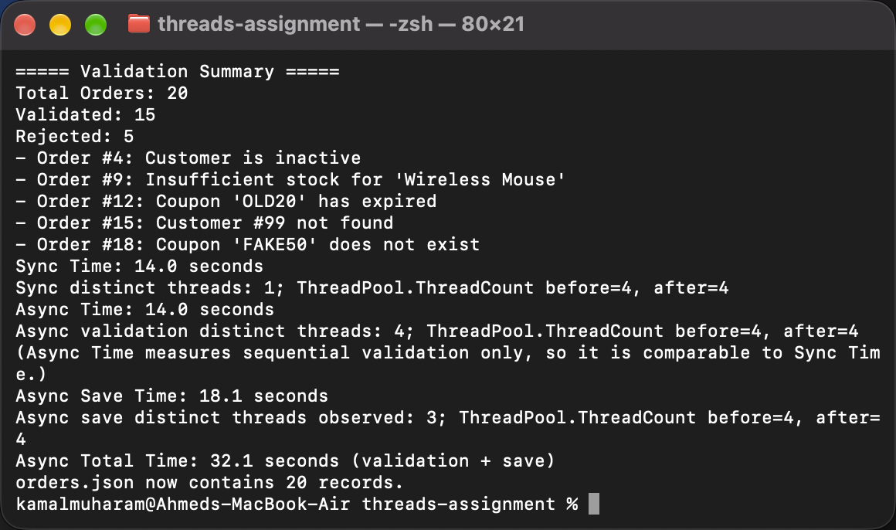

### Phase 2
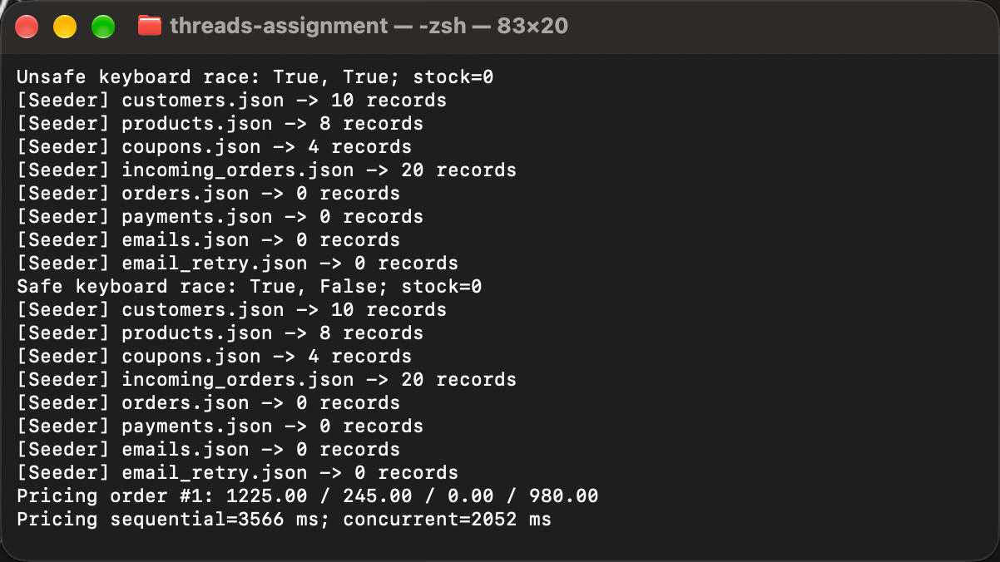

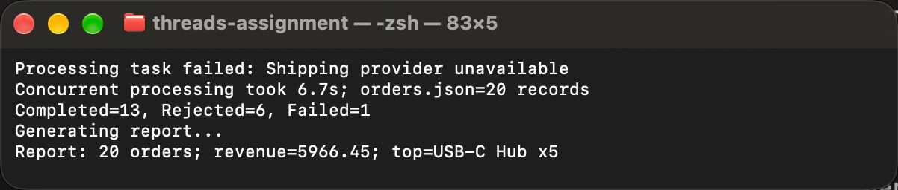

### Phase 3
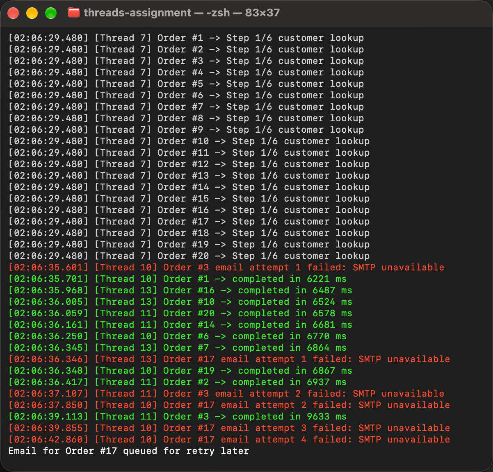

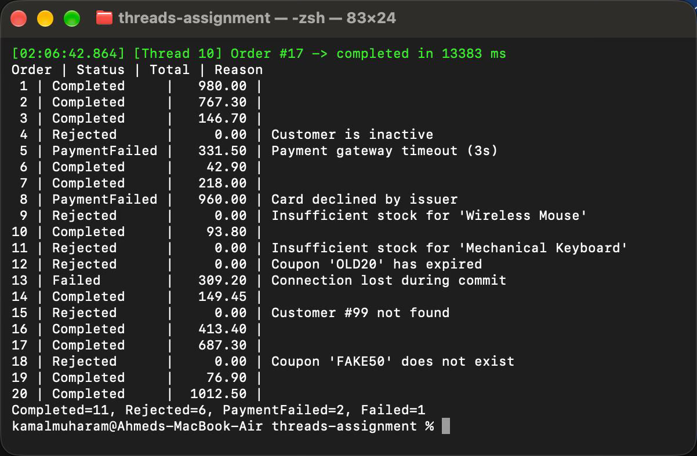

Run `dotnet run --project "06-OrderProcessing/OrderProcessing/OrderProcessing.csproj" -- phase3 --comparison` for the required 10-order sync-versus-async comparison. Ahmed's captured run took 18940 ms on 10 dedicated threads and 6957 ms with 8 observed async threads. Both versions produced 8 Completed and 2 Rejected.

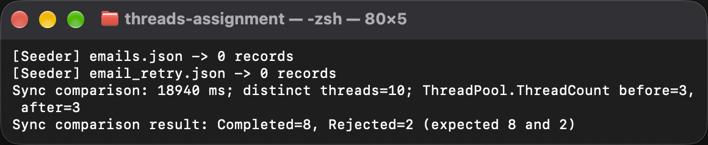

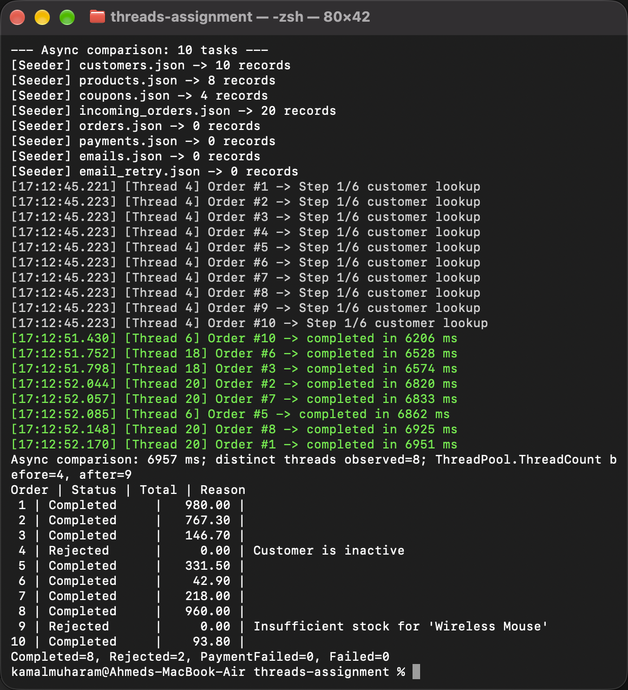

Run `dotnet run --project "06-OrderProcessing/OrderProcessing/OrderProcessing.csproj" -- phase3 --fireforget` for both required fire-and-forget demonstrations. The broken method returns before SMTP reports its failure; the fixed method awaits SMTP and the caller observes the exception.

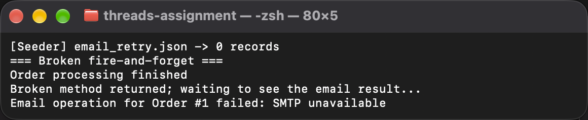

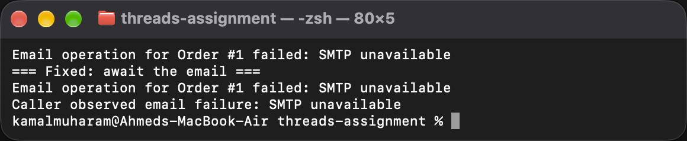

### Phase 4
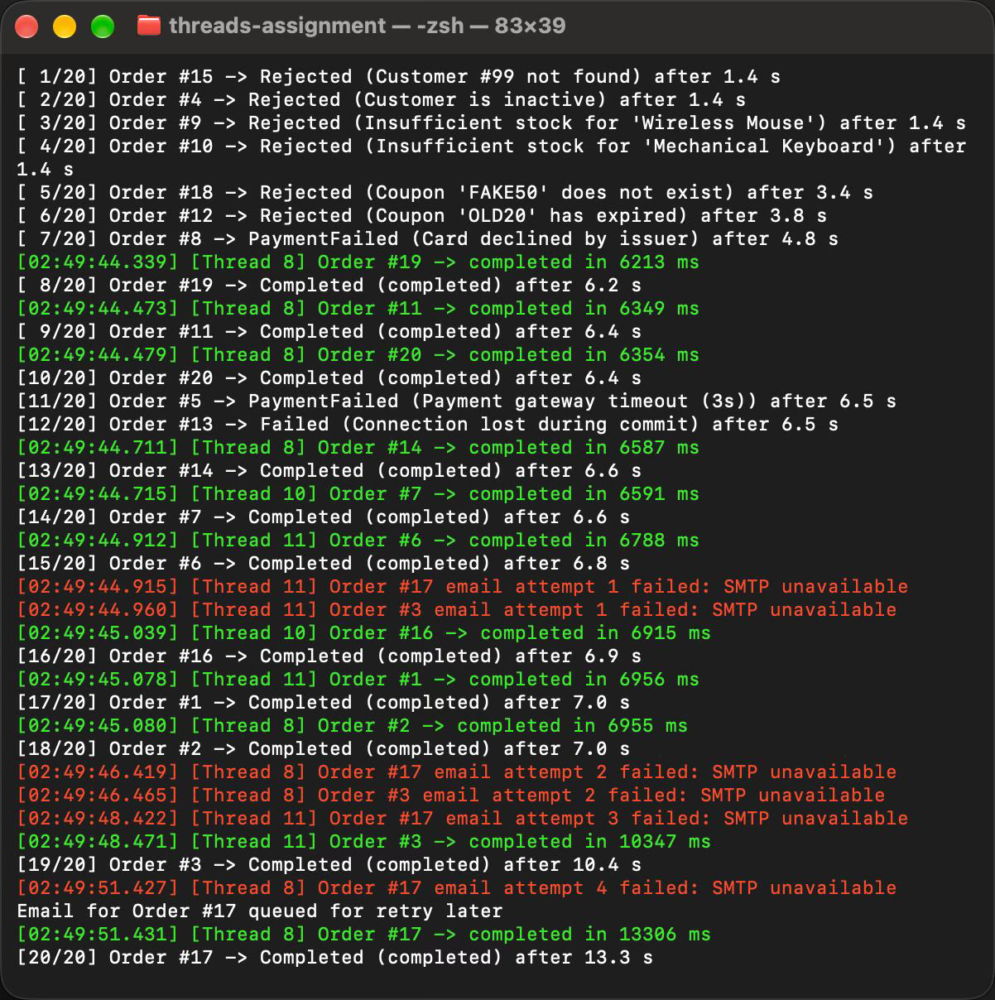

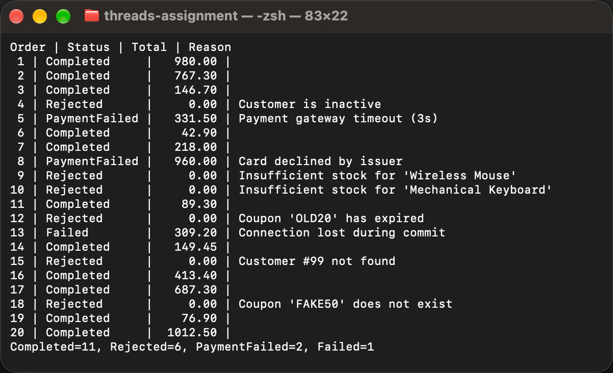

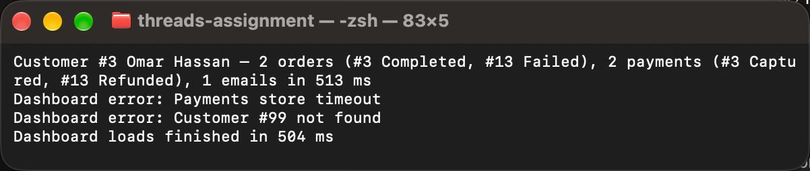

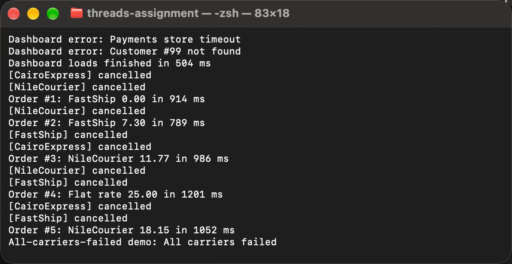

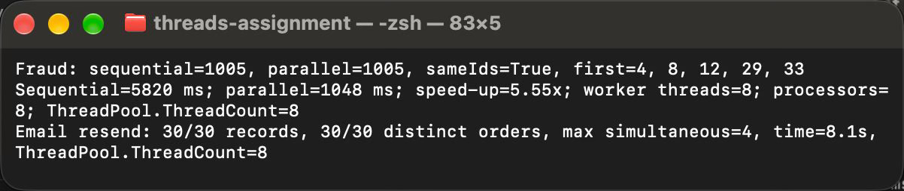

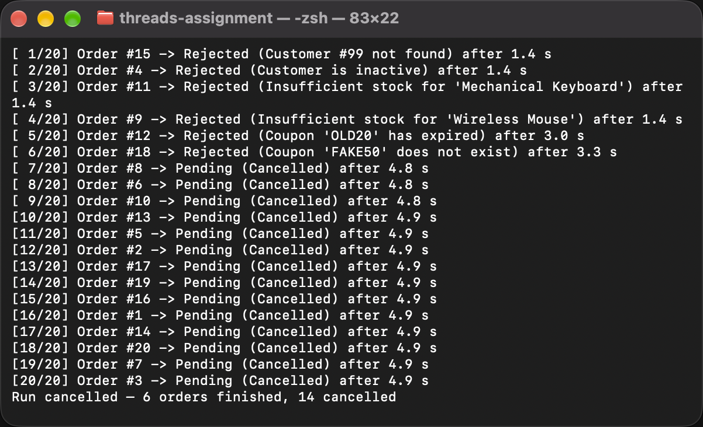

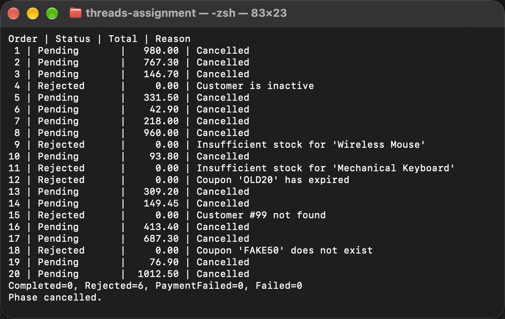

The Phase 3 comparison and fire-and-forget screenshots above show the new demonstrations. The Phase 1 screenshot has been updated and matches the measurements in the table: 14.0 seconds for async validation, 18.1 seconds for async saving, and 32.1 seconds total. The Phase 2 and Phase 4 timing values in the table have been synchronized with their existing screenshots. Keep the existing Phase 3 checkout and cancellation screenshots if their output has not changed.

## JSON snapshots

The actual collection JSON files from each phase run are copied to `sample-output/phase1/` through `sample-output/phase4/`. Phase 2 also includes its generated report JSON under `sample-output/phase2/reports/`. These are snapshots, not runtime `Data/`, `bin/`, or `obj/` folders.
